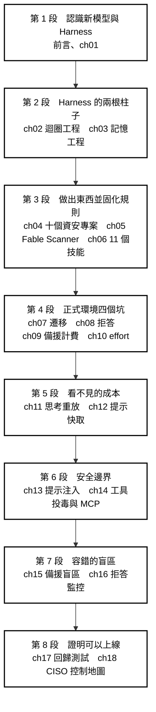
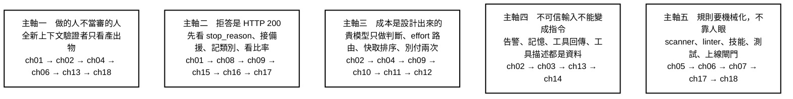

# K143 知識地圖：一張圖看懂《用 Claude Fable 5 與 Mythos 5 打造代理式 AI 工程》

> 原書：*Engineering Agentic AI with Claude Fable 5 and Mythos 5*，Ken Huang 等著。
> 本文是依各章重點整理的架構導讀，不含書籍原文。2026-11-22 整理。
> 書附範例程式碼：作者公開的 kenhuangus/fable5（MIT 授權）。

## 一、全書一句話定位

**模型變強之後，工程重心從「把提示詞寫得精巧」移到「圍繞模型搭一套 Harness（目標、邊界、驗證、停止條件、記憶、備援、監控），再把它管到可以上線、可以通過資安長（CISO）簽核」。**

翻目錄會看到：迴圈、記憶、十個資安專案、掃描器、技能、遷移、拒答、備援、effort、思考重放、快取、提示注入、工具投毒、回歸測試、CISO……
看起來像一串零散主題，其實全書是一條主線：

**先認識新模型 → 搭出會自己收斂的迴圈與記憶 → 用「昂貴規劃、廉價建置」做真實專案並把規則固化 → 把正式環境的每個坑（拒答、備援、成本、思考、快取）補起來 → 守住安全邊界 → 用測試與上線閘門證明它可以上線。**

## 二、章節分段架構：8 段／18 章對照

全書 18 章，本知識地圖依閱讀分段切成 8 段（與 K143 簡報網站的 8 段一致）：

| 段 | 章節 | 主題 | 這一段要學會的一句話 |
| --- | --- | --- | --- |
| 1 | 前言＋ch01 | 改變了什麼：Fable 5、Mythos 5 與 Harness | 舊鷹架在新模型上反而有害，要改給目標、邊界、驗證與停止條件 |
| 2 | ch02–03 | 迴圈工程、記憶工程 | 做的人不當審的人；記憶要有出處、有檢疫 |
| 3 | ch04–06 | 安全專案組合、Fable Scanner、11 個原生技能 | 貴模型只花在判斷最密集的地方；舊鷹架用工具機械化清掉；好規則固化成技能 |
| 4 | ch07–10 | 遷移機隊、看不見的拒答、備援計費、effort 成本 | 拒答是 HTTP 200；備援要接好且別付兩次錢；effort 就是成本旋鈕 |
| 5 | ch11–12 | 自適應思考與重放陷阱、提示快取經濟學 | 同模型保留思考區塊、換模型剝掉；快取是位元組前綴，長存活期放前面 |
| 6 | ch13–14 | 提示注入防禦、工具投毒與 MCP 安全 | 四層漏斗把不可信輸入擋在不可逆動作之前；工具描述也要稽核 |
| 7 | ch15–16 | 備援靜默失效、儀表板看不見的拒答 | 批次、雲端託管、巢狀子呼叫沒有備援；告警看比率不看次數 |
| 8 | ch17–18 | 回歸測試、CISO 控制地圖 | 用性質斷言與金絲雀取代逐字比對；10 個布林條件全真才准上線 |

也可以把 8 段再收成六大部分理解：**認識（1）→ 建構（2）→ 實作（3）→ 上線工程（4、5）→ 安全（6、7）→ 治理（8）**。

## 三、各段核心概念

### 第 1 段：改變了什麼（前言、ch01）

- Fable 5 與 Mythos 5 是同一能力等級的兩種部署：Fable 一般可用、帶安全分類器；Mythos 只開放給經核准的防禦性資安專案。兩者都是 1M 上下文、思考永遠開著。
- 舊鷹架（大寫 IMPORTANT、YOU MUST、十幾條條列、要求逐步說出思考、顯示剩餘 token）在新模型上有害：有的讓它提早收工，有的直接觸發拒答。
- 第一天就能用的五個提示詞模組：**邊界、接地進度、自主性、白話摘要、上下文平靜**。
- 範例 README 的六條 API 注意事項：不送 thinking 參數、用 effort 控深度、每個請求都接備援、先看 stop_reason 再讀內容、Mythos 另有範圍閘門、做的人不當審的人。這六條就是全書後面各章的目錄預告。

### 第 2 段：迴圈與記憶（ch02–03）

- **迴圈六零件**：觸發、規則、執行者、全新上下文的驗證者、記憶、停止條件。範例有深度研究迴圈（每條主張三個對抗式投票者）與 SOC 告警分流迴圈（告警內容視為攻擊者寫的不可信輸入）。
- **成本路由**：規劃與審核用高階模型，中段實作用便宜模型。
- **檔案式記憶**：一個索引檔＋一課一檔，每筆附出處；官方記憶工具是客戶端執行，安全由你負責（路徑不能逃出根目錄、單檔上限 32 KB）。
- **記憶是攻擊面**：開機檢疫把祈使句、帶網址或密碼、沒有出處的教訓移到隔離區；再加上定期整理迴圈清掉重複與過時教訓。

### 第 3 段：做出東西並固化規則（ch04–06）

- **昂貴規劃、廉價建置**：prep（便宜模型整理工作封包）→ plan_or_audit（Fable 5 做判斷）→ execute（便宜模型照做）→ verify（全新上下文審查）。共用迴圈 `job_packet/packet.py` 套在十個資安專案上（威脅建模、MCP 稽核、成本儀表板、重構舊程式、政策轉程式、GRC、上線前稽核、SOC 儀表板、遷移、紅隊箱）。
- **一句話測試**：沒有分支、沒有判斷的任務，交給最便宜做得到的模型，甚至純 Python。
- **Fable Scanner**：`scan`（靜態抓反模式）、`canary`（固定提示詞比基準線）、`monitor`（讀本機回應紀錄統計拒答與花費）。舊鷹架要機械化清掉。
- **11 個原生技能**：effort 路由、範圍圍欄、不鍍金、證據綁定進度、夠了就動手、驗證子代理、自主契約、教訓記憶、讀者優先摘要、拒答感知呼叫、Mythos 範圍閘門。任務型技能會自動觸發，常駐行為規則要明確呼叫或貼進系統提示詞。

### 第 4 段：正式環境四個坑（ch07–10）

- **遷移**：temperature、top_p、top_k、手動 thinking 預算在 Fable 5 直接回 400；舊思考區塊帶到新模型會被當無效輸入 token 計費。用 migration_linter 在 CI 擋。
- **拒答**：不是例外，是 HTTP 200＋`stop_reason: "refusal"`＋空 content。先看 stop_reason，再從 usage.iterations 判斷是 Fable 回答還是備援接住；拒答類別有 cyber、bio、frontier_llm、reasoning_extraction。
- **備援計費**：自己寫重試時要原樣帶回 fallback_credit_token，且請求本體必須完全一致，否則付兩次快取寫入。
- **effort**：low、medium、high、xhigh、max 五級，不設就是 high；影響所有輸出 token（文字、工具呼叫、思考）。把機隊成本政策寫成一個函式 `effort_for()`。

### 第 5 段：看不見的成本（ch11–12）

- **思考重放兩條相反規則**：同模型繼續對話，思考區塊原封不動保留（連空的也不能刪）；轉給別的模型，思考區塊整個剝掉。日誌清洗程式「好心」過濾空區塊，下一輪就 400。
- **提示快取**：嚴格位元組前綴比對；5 分鐘快取寫入 1.25 倍、複用 1 次回本，1 小時快取寫入 2 倍、複用 2 次打平。長存活期、最穩定的內容放最前面。

### 第 6 段：安全邊界（ch13–14）

- **提示注入四層漏斗**：1 把不可信內容標成資料（圍欄標籤，並過濾偽造結尾標籤）→ 2 邊界模組先評估、沒批准不行動 → 3 驗證閘門比對提議動作有沒有超出原請求 → 4 最小權限工具，前三層都破了也做不到。
- **工具投毒**：指令藏在 MCP 工具描述或回傳值，在挑工具階段就生效。工具描述要稽核、權限最小化、工具清單釘版本；MCP 工具內部的巢狀模型呼叫不會繼承備援。

### 第 7 段：容錯的盲區（ch15–16）

- **備援盲區**：批次 API、雲端平台託管端點、工具內部巢狀子呼叫都沒有伺服器端備援，要客戶端補第二輪。
- **分清錯誤類型**：只有拒答該轉備援；429、過載、逾時要退避重試同一個模型。
- **拒答監控**：遙測要記 stop_reason、拒答類別、是否由備援服務；分類器重訓可能讓 cyber 拒答率無預警上升；告警看各類別佔總請求的比率。

### 第 8 段：證明可以上線（ch17–18）

- **回歸測試**：輸出不是確定性的，改用結構綱要＋性質斷言（合法 JSON、必要欄位、長度範圍、關鍵詞），加上金絲雀基準線的容差監控；不同 effort 分開斷言。
- **CISO 控制地圖**：五大領域（資料、可用性、成本、完整性、保證）；10 個不可覆寫的布林上線條件：模型版本記錄、資料保留已簽核、拒答路徑已接、備援盲區已補、Mythos 範圍封包、Mythos 產出管控、記憶檢疫、MCP 最小權限、注入邊界、驗證者在線。任一為 false 就不准碰正式流量。

## 四、彼此關係：貫穿全書的五條主軸

章節是橫的，下面五條是縱的。抓住它們，18 章就串起來了：

1. **做的人不當審的人**：同上下文自我審查會漏掉「沒真的跑卻標通過」；所以研究迴圈、SOC 迴圈、十個專案、驗證子代理技能、注入防禦第三層、CISO 閘門「驗證者在線」都是同一個原則。
2. **拒答是 HTTP 200**：第 1 章預告，第 8 章講怎麼讀，第 9 章講備援怎麼計費，第 15 章講哪裡沒有備援，第 16 章講怎麼監控，第 17 章講怎麼測。
3. **成本是設計出來的**：成本路由、一句話測試、effort 函式、思考區塊剝除、快取排序、fallback credit，全部是「同一件事別付兩次錢、便宜的事別用貴模型」。
4. **不可信輸入不能變成指令**：SOC 告警、被下毒的記憶、工具回傳值、工具描述，都要當成資料處理，並在不可逆動作前設關卡。
5. **規則要機械化**：作者兩次「稽核第三方工具後決定自己重寫」（scanner 與技能集）；舊鷹架用 scanner 清、遷移用 linter 擋、規則固化成技能、品質用測試證明、上線用布林閘門判定。

**一句話記住整本書：給目標不給步驟、做的不審、拒答先看、成本先算、輸入不信、規則上機器。**

## 五、關鍵術語表

| 術語 | 白話解釋 | 主要章節 |
| --- | --- | --- |
| Fable 5 | 一般可用的新一代模型，帶安全分類器，1M 上下文、思考永遠開著 | ch01 |
| Mythos 5 | 同能力等級、只開放給核准防禦性資安專案的版本，要另有範圍閘門 | ch01、ch06、ch18 |
| Harness | 圍繞模型的工程外殼：目標、邊界、驗證、停止條件、記憶、備援、監控 | ch01 |
| 舊鷹架（scaffolding） | 舊世代提示技巧：大寫強調、YOU MUST、逐步說思考、顯示剩餘 token | ch01、ch05 |
| 五個提示詞模組 | 邊界、接地進度、自主性、白話摘要、上下文平靜 | ch01 |
| 控制迴圈六零件 | 觸發、規則、執行者、驗證者、記憶、停止條件 | ch02 |
| 驗證子代理（verifier） | 在全新上下文只看產出物、回 PASS/FAIL 的審查者 | ch02、ch06 |
| 開機檢疫（startup scan） | 載入記憶前先掃，把可疑教訓移到隔離區 | ch03 |
| 出處行（provenance） | 每筆記憶附上「從哪裡學到」的證據 | ch03 |
| 工作封包（job packet） | prep → plan_or_audit → execute → verify 的共用迴圈 | ch04 |
| 一句話測試 | 沒分支沒判斷的任務交給最便宜做得到的模型或純 Python | ch04 |
| fable_scanner | scan、canary、monitor 三個子指令的提示詞與遙測工具 | ch05 |
| SKILL.md 技能 | 把規則固化成可安裝的技能檔，分任務型與常駐行為型 | ch06 |
| migration_linter | 掃請求本體找出會 400 或白付錢的欄位，CI 擋 error | ch07 |
| stop_reason: refusal | 拒答的真正樣子：HTTP 200、空 content | ch08 |
| 拒答類別 | cyber、bio、frontier_llm、reasoning_extraction | ch08、ch16 |
| fallback_credit_token | 拒答時附的一次性折抵憑證，重試原樣帶回才不付兩次錢 | ch09 |
| 黏性路由（sticky） | 這一輪直接由備援服務，要和真正的備援分開統計 | ch09 |
| effort | low／medium／high／xhigh／max，控制所有輸出 token 的行為訊號 | ch10 |
| 思考區塊重放 | 同模型保留、換模型剝除 | ch11 |
| 提示快取 | 位元組前綴比對，5 分鐘與 1 小時兩種存活期 | ch12 |
| 四層注入漏斗 | 標記資料、邊界評估、驗證閘門、最小權限工具 | ch13 |
| 工具投毒 | 指令藏在 MCP 工具描述或回傳值 | ch14 |
| 備援盲區 | 批次 API、雲端託管端點、巢狀子呼叫不繼承備援 | ch15 |
| 比率告警 | 依各類別拒答佔總請求比例設漂移門檻 | ch16 |
| 性質斷言／金絲雀 | 取代逐字比對的非確定性輸出測試方法 | ch17 |
| CISO 控制地圖 | 五大領域＋10 個布林上線條件 | ch18 |

## 六、閱讀路線建議

**三遍讀法（推薦）**

1. **第一遍：第 1 段＋第 2 段（ch01–03）**。把五個提示詞模組、迴圈六零件、檔案式記憶抄成自己的範本。這三章是全書的「作業系統」，後面每章都在補它。
2. **第二遍：依角色挑一條線**，只讀那幾章：
   - 要把現有系統換到新模型的工程師：ch07 → ch08 → ch09 → ch10 → ch11 → ch12（第 4、5 段）。
   - 做資安、SOC、紅隊的人：ch04 → ch13 → ch14 → ch15（第 3、6、7 段）。
   - 管成本與平台的人：ch04 → ch10 → ch12 → ch09 → ch16。
   - 寫 Claude Code 工作流程的人：ch05 → ch06（scanner 與技能可直接套到 CLAUDE.md 與 SKILL.md）。
3. **第三遍：第 8 段（ch17–18）**。用 CISO 10 項布林條件回頭檢查你自己的系統，哪一項是 false 就回到對應章節補。

**時間很少時的最短路線**：ch01（為什麼要變）→ ch02（迴圈）→ ch08（拒答）→ ch18（上線閘門）。

**搭配本 repo 練習**：每章 `prompts/chNN.md` 有練習提示詞，範例透過 `practice/claude_cli_client.py` 轉接層走 `claude -p`，不需要 API 金鑰。第 11～16 章書附 repo 沒有對應資料夾，練習改為依觀念自寫小工具。

## 七、補充分析：代理人用 Python 還是 .claude/agents/*.md？

讀這本書時很容易冒出一個問題：書裡的代理人，能不能直接用 Claude Code 的 `.claude/agents/*.md`（子代理定義檔）來做？以下是對照分析。

### 1. 本書的做法：全部用 Python 自己寫迴圈

- 代理人幾乎全用 **Python＋anthropic 套件**（`client.beta.messages.create`）自己寫迴圈。
- 第 2 章的 `triage_loop.py`（SOC 告警分流）與 `research_loop.py`（深度研究）用程式組出觸發、執行者、驗證者、記憶、停止條件。
- 第 4 章十個資安專案全是 `.py`；所謂「驗證 subagent」，其實是程式再呼叫一次 API、給它全新的上下文。
- 第 6 章 11 個 `SKILL.md` 是技能說明，由程式讀進 system prompt（也可當 Claude Code 外掛安裝）。
- 全書**沒有使用 `.claude/agents/*.md`，也沒有使用 Claude Agent SDK**。

### 2. .md 代理人做得到的

- frontmatter 可以指定 `model`、`tools`、`permissionMode`、`skills`、`memory`、`isolation`；正文就是 system prompt。
- 加上 hooks 可以強制檢查（例如工具呼叫前後驗證）。
- 原型、資安分析、研究類工作，大多可以用 .md 代理人做。

### 3. .md 代理人做不到或不穩的

- **迴圈與停止條件無法保證**：寫在提示詞裡，模型可能不照做。
- **拿不到 API 底層**：stop_reason 拒答、token 用量、每次呼叫的 effort、拒答時自動換模型。
- **子代理不能再派子代理**：多層代理受限。
- **難寫自動化測試與回歸測試**。
- **排程、webhook、部署**需要另外包一層 `claude -p`。

**對照本書章節**：

| 章節 | 適合 .md 代理人？ | 原因 |
| --- | --- | --- |
| ch04 十個資安專案、ch06 11 個技能 | 適合 | 以判斷與分析為主，技能本來就是 SKILL.md |
| ch07–10 拒答、備援、effort 成本 | 必須用程式 | 需要讀 stop_reason、帶 fallback credit、逐次設 effort |
| ch17–18 回歸測試、CISO 控管 | 必須用程式 | 需要自動化斷言、金絲雀基準線、可稽核的布林閘門 |

### 4. 純 Python 的優缺點

| 優點 | 缺點 |
| --- | --- |
| 流程確定（迴圈與停止條件由程式保證） | 開發慢 |
| 拿得到底層資訊（stop_reason、usage、effort） | 要付 API 費用，不走 Max 訂閱 |
| 錯誤處理完整 | 要管 API 金鑰 |
| 可自動化測試與 CI | 工具要自己做 |
| 部署彈性大 | 維護成本高 |
| 多層代理沒有限制 | 改行為要改程式、重新部署 |
| 成本可稽核 | |

### 5. 選擇建議

- **個人工作流程**：用 `.claude/agents/*.md`，快、免 API 費、改提示詞就改行為。
- **要上線、給別人用、要證明合規**：用純 Python（本書路線），因為拒答、備援、成本、測試、CISO 閘門都需要程式層的保證。
- **折衷路線**：先用 .md 代理人做原型，驗證流程可行後再改寫成 Python。
